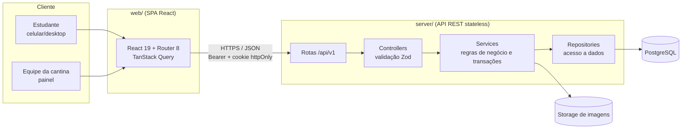
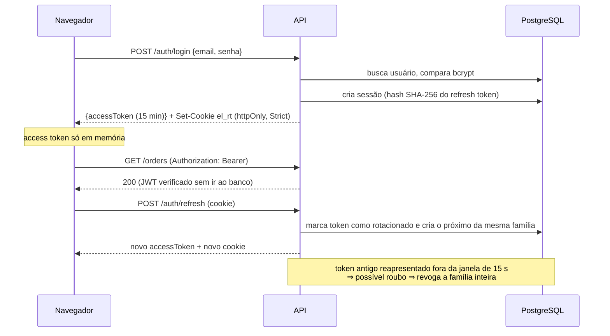
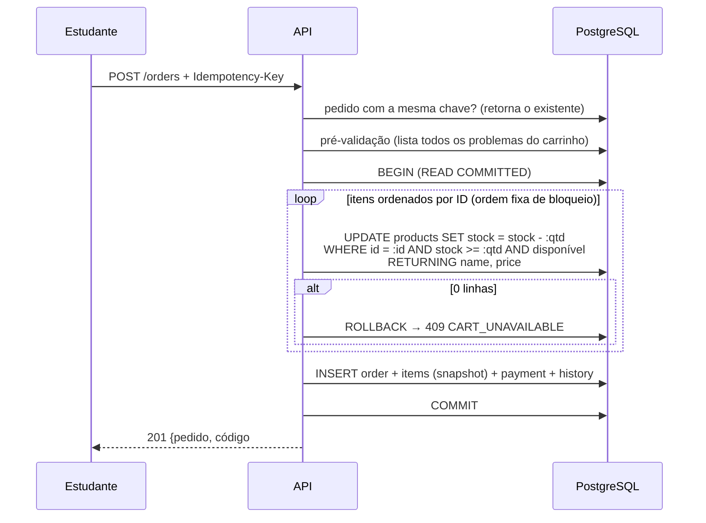
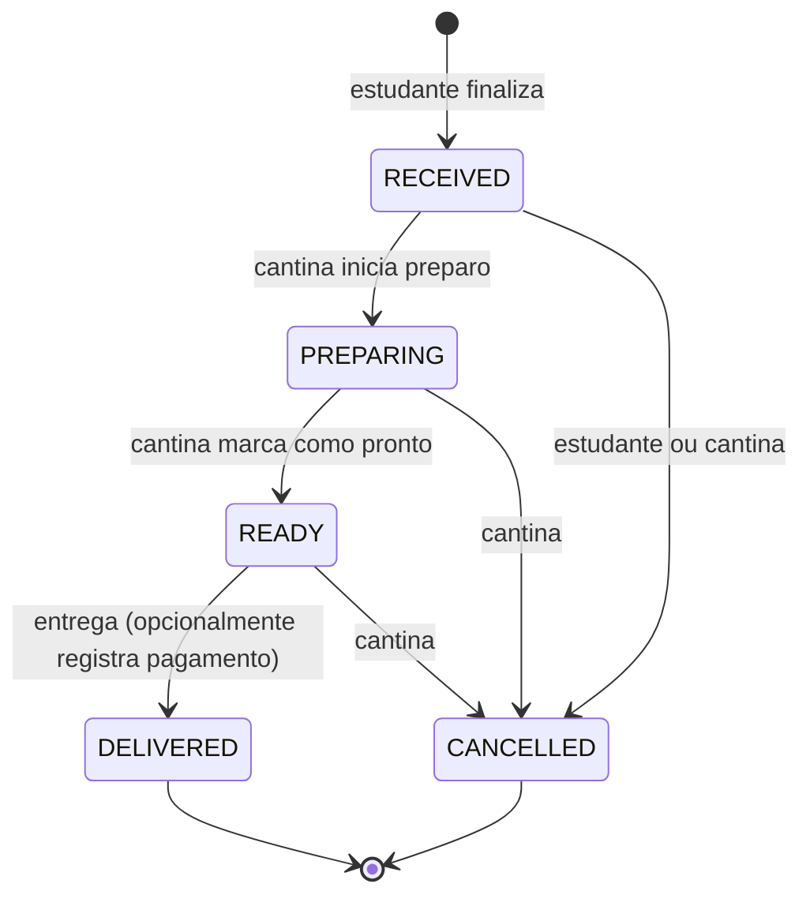

# Arquitetura do EstuLanches

Este documento descreve as decisões de arquitetura, o modelo de dados, os fluxos críticos e o caminho de evolução para alta escala (1 milhão de usuários cadastrados e 100 mil simultâneos).

## 1. Visão geral



- **Monorepo** com npm workspaces: `server/` (API) e `web/` (SPA), que se comunicam apenas pelo contrato REST versionado (`/api/v1`).
- **API stateless:** nenhuma sessão em memória. O access token JWT é verificado sem consultar o banco, e o estado persistente (refresh tokens, pedidos) fica no PostgreSQL. Por isso qualquer instância pode atender qualquer requisição.

## 2. Camadas do backend

| Camada | Responsabilidade | Exemplo |
|---|---|---|
| **Routes** | Mapear URL, verbo e middlewares (autenticação, RBAC, rate limit) | `orders.routes.ts` |
| **Controllers** | Validar entrada (Zod) e formatar a resposta HTTP | `orders.controller.ts` |
| **Services** | Regras de negócio, transações e orquestração | `orders.service.ts` |
| **Repositories** | Consultas Prisma e SQL parametrizado | `orders.repository.ts` |
| **Mappers** | Converter entidades em DTOs (sem vazar campos internos) | `orders.mapper.ts` |

Infraestrutura transversal: `config/env.ts` (variáveis validadas na inicialização), `lib/` (Prisma, logger, tokens, senhas, storage), `middlewares/` (autenticação, autorização, rate limit, upload, tratamento de erros, logs por requisição) e `shared/` (erros de domínio, dinheiro com `Decimal`, paginação, fuso horário).

## 3. Modelo de dados

```mermaid
erDiagram
  users ||--o| students : "perfil"
  users ||--o{ sessions : "refresh tokens"
  students ||--o{ orders : "faz"
  orders ||--|{ order_items : "contém"
  products ||--o{ order_items : "vendido em"
  categories ||--o{ products : "agrupa"
  orders ||--|| payments : "tem"
  orders ||--o{ order_status_history : "auditoria"
  users ||--o{ order_status_history : "alterou"

  users { uuid id PK; varchar email UK; varchar password_hash; enum role; bool is_active }
  students { uuid id PK; uuid user_id FK,UK; varchar registration UK; varchar grade }
  sessions { uuid id PK; uuid user_id FK; uuid family_id; char token_hash UK; timestamptz expires_at; timestamptz rotated_at; timestamptz revoked_at }
  categories { uuid id PK; varchar name UK; varchar slug UK; int sort_order; bool is_active }
  products { uuid id PK; uuid category_id FK; varchar name; decimal price; int stock; bool is_available; varchar image_key; timestamptz archived_at }
  orders { uuid id PK; varchar code UK; uuid student_id FK; enum status; decimal total; varchar idempotency_key }
  order_items { uuid id PK; uuid order_id FK; uuid product_id FK; varchar product_name; decimal unit_price; int quantity }
  payments { uuid id PK; uuid order_id FK,UK; enum method; enum status; decimal amount; timestamptz paid_at }
  order_status_history { uuid id PK; uuid order_id FK; enum status; uuid changed_by_id FK; varchar note }
```

**Decisões de modelagem**

- **UUID v7** como chave primária: único globalmente (permite gerar IDs fora do banco e fazer *sharding* no futuro) e ordenado no tempo, o que mantém boa localidade nos índices B-tree.
- **`timestamptz` em todas as datas**, sempre armazenadas em UTC. O fuso da escola é aplicado apenas na apresentação e nas agregações (`APP_TIMEZONE`).
- **Snapshots imutáveis** em `order_items` (`product_name`, `unit_price`) e `orders.total`: o histórico nunca muda quando o catálogo muda.
- **Exclusão lógica de produtos** (`archived_at`): produtos com vendas são arquivados, e a chave estrangeira `ON DELETE RESTRICT` impede apagá-los fisicamente.
- **Integridade no próprio banco:** chaves estrangeiras, índices únicos (e-mail, matrícula, código do pedido, `(student_id, idempotency_key)`, `token_hash`) e `CHECK` constraints (estoque ≥ 0, preço > 0, quantidade > 0, `PAID ⇒ paid_at`).
- **Índices pensados para as consultas reais:** `orders(student_id, created_at DESC)` para o histórico do aluno, `orders(status, created_at)` para o quadro da cantina, `orders(created_at)` para o dashboard, `products(category_id, is_available)` para o cardápio e `sessions(family_id)`, `sessions(expires_at)` para revogação e limpeza.

## 4. Autenticação e sessão



- Access token curto (15 min) e **em memória**: não fica exposto a XSS via `localStorage`.
- Refresh token opaco em cookie `httpOnly` + `SameSite=Strict` + caminho restrito, com checagem de origem como defesa extra contra CSRF.
- **Rotação com detecção de reuso**, com uma janela de 15 s para abas que renovam ao mesmo tempo. Logout e desativação do usuário revogam as sessões no banco.
- O cliente renova o token de forma proativa (1 min antes de expirar) e reativa (em caso de 401), com *single-flight*, e sincroniza login e logout entre abas via `BroadcastChannel`.

## 5. Checkout e concorrência



- O `UPDATE` condicional é **atômico**: o PostgreSQL bloqueia a linha do produto e, em escritas concorrentes, reavalia `stock >= qtd` sobre a versão mais recente. Entre duas compras simultâneas da última unidade, só uma afeta a linha.
- A ordem fixa de bloqueio (itens ordenados por ID) evita *deadlocks* entre pedidos com os mesmos produtos.
- O `RETURNING` captura nome e preço no mesmo instante da baixa de estoque. O total é calculado no servidor com `Decimal`, sem nunca confiar em preços enviados pelo cliente.
- Defesa em profundidade: `CHECK (stock >= 0)` no banco.
- **Idempotência:** índice único `(student_id, idempotency_key)`. Reenvios devolvem o pedido original (`200` + `Idempotent-Replayed: true`).
- O código curto do pedido é aleatório, com alfabeto sem caracteres ambíguos. Em caso de colisão, a transação é repetida.

## 6. Máquina de estados do pedido



As transições acontecem dentro de uma transação com `SELECT … FOR UPDATE`, que serializa mudanças concorrentes. O cancelamento devolve o estoque com incremento atômico e muda o pagamento (`PENDING → CANCELLED`, `PAID → REFUNDED`). Cada transição gera um registro em `order_status_history` com autor e motivo.

## 7. Frontend

- **Organização por domínio** (`features/`): cada domínio reúne sua API tipada, hooks do TanStack Query e componentes. `components/ui` é o design system próprio (tokens no `@theme` do Tailwind 4).
- **Estado de servidor** no TanStack Query (cache, *refetch* em foco, *polling*, invalidação após mutações). **Estado local** em contextos enxutos (sessão e carrinho).
- **Code splitting por página:** o painel, que carrega Recharts, nunca pesa para o estudante.
- **Acessibilidade:** diálogos com `<dialog>` nativo (foco preso, ESC), rótulos e `aria-*`, contraste validado nas cores dos gráficos, visão em tabela para cada gráfico e suporte a `prefers-reduced-motion`.
- **Tempo real na v1 via polling:** quadro da cantina a cada 10 s, pedido do estudante a cada 8 s enquanto ativo e cardápio a cada 30 s. O polling só roda enquanto há algo em andamento.

## 8. Segurança (resumo por camada)

| Camada | Medidas |
|---|---|
| Transporte | HTTPS (produção), HSTS, cookies `Secure` |
| Borda da API | Helmet, CORS por lista de origens, limite de corpo de 100 KB, rate limiting por perfil de rota |
| Identidade | bcrypt custo 12, JWT curto, refresh rotativo com hash, revogação, contas desativáveis |
| Autorização | RBAC por rota + escopo por dono do recurso (404 para recursos de terceiros) |
| Entrada | Zod em corpo, query, params e headers; textos sanitizados; SQL sempre parametrizado |
| Arquivos | *Magic bytes*, sem SVG, tamanho máximo, nomes aleatórios, `nosniff` + CSP nas imagens |
| Saída | Erros padronizados sem detalhes internos; logs com dados sensíveis mascarados |

## 9. Escalabilidade: de uma escola a 100 mil usuários simultâneos

A versão inicial é deliberadamente simples, e cada peça foi escolhida para poder evoluir sem reescrita.

### 9.1 O que já está pronto para escalar
- **API stateless:** escala horizontal atrás de um balanceador (round-robin, sem *sticky sessions*). `TRUST_PROXY`, `keepAliveTimeout` acima do balanceador, *graceful shutdown* e probes `/health/live` e `/health/ready` já estão configurados.
- **Banco preparado:** índices alinhados às consultas, agregações do dashboard feitas no PostgreSQL (sem trazer linhas para a aplicação), UUID v7 e transações curtas.
- **Pontos de extensão explícitos:** `ImageStorage` (troca de disco por S3/R2), store do rate limit (troca por Redis) e `menuService` (ponto natural de cache).

### 9.2 Roteiro de evolução

| Gatilho | Evolução |
|---|---|
| Mais de 1 instância da API | **Redis** para o rate limit distribuído (`rate-limit-redis`); imagens em **storage de objetos + CDN** |
| Muitas conexões no banco | **PgBouncer** (pool em modo transação) entre API e PostgreSQL; ajuste do pool por instância |
| Leitura intensa do cardápio | **Cache no Redis** do `GET /menu` (TTL curto + invalidação nas mutações de catálogo); `ETag`/`304` |
| Dashboard pesado | Cache de 30–60 s por chave; **tabelas de resumo diárias** atualizadas por job; réplicas de leitura para relatórios |
| Muitos usuários acompanhando pedidos | Trocar polling por **SSE/WebSocket** com **Redis pub/sub** (eventos de mudança de status), mantendo a API stateless |
| Tarefas lentas ou periódicas | **Fila** (BullMQ/Redis ou SQS) para notificações, relatórios, limpeza de sessões e reprocessamentos |
| Volume histórico grande | **Particionamento** de `orders`/`order_items` por mês; arquivamento de dados frios |
| Operação | **Observabilidade**: logs JSON (já existentes) para Loki/ELK, métricas e tracing com OpenTelemetry + Prometheus/Grafana, alertas sobre latência p95, erros 5xx e saturação do pool |

### 9.3 Estimativa de carga (100 mil simultâneos)

- Com polling de 10 s, 100 mil sessões ativas geram cerca de **10 mil req/s** de leitura. Cada requisição é leve, mas esse é o principal motivo para migrar para SSE/WebSocket com pub/sub nessa escala.
- Picos de checkout acontecem nos intervalos escolares. O gargalo é a contenção por linha de produto populares, e o `UPDATE` condicional com transações curtas mantém o bloqueio em milissegundos. Em cenários extremos (milhares de compras por segundo do mesmo item), uma reserva de estoque em Redis com reconciliação assíncrona alivia o banco.
- **1 milhão de cadastros** é um volume modesto para o PostgreSQL com os índices atuais. Tabelas de sessão são limpas periodicamente (job idempotente já implementado).

## 10. Trade-offs assumidos

- **Polling** em vez de WebSocket na v1: simplicidade e escalabilidade horizontal imediata, ao custo de alguns segundos de latência na atualização.
- **Rate limit em memória** por instância: suficiente para uma instância; precisa de Redis antes de escalar horizontalmente.
- **Imagens em disco local:** adequado a desenvolvimento e instância única; produção com várias instâncias exige storage de objetos.
- **Pagamentos sem integração financeira:** o sistema registra modalidade e status (`PENDING`, `PAID`, `REFUNDED`, `CANCELLED`). A integração com um PSP (ex.: PIX dinâmico) pode ser adicionada ao `Payment` sem mudar o fluxo do pedido.
